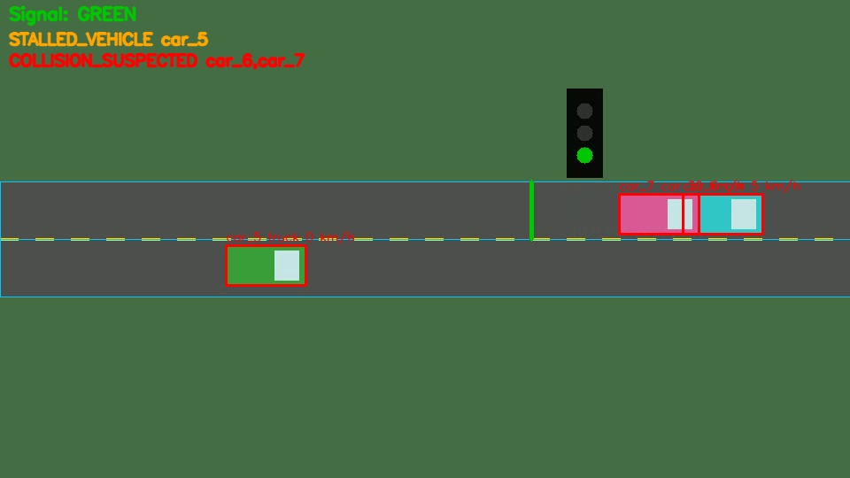

# Computer Vision-Based Traffic Violation & Emergency Detection System

Detects traffic violations and emergency situations from roadside camera video:
vehicles and pedestrians are detected and tracked, converted to real-world speed using
camera calibration, and checked against a configurable rule engine. Every event is
logged (CSV + JSONL) with an annotated snapshot for human review.



## What it detects
| Category | Event | How |
|----------|-------|-----|
| Violation | `SPEEDING` | Ground-plane speed (homography) above the limit for N frames |
| Violation | `RED_LIGHT_VIOLATION` | Vehicle crosses the stop line while the signal is red |
| Violation | `WRONG_WAY` | Motion opposes the lane's allowed direction |
| Violation | `ILLEGAL_STOPPING` | Stationary inside a no-stopping zone beyond a time limit |
| Emergency | `COLLISION_SUSPECTED` | Overlapping vehicles + sudden deceleration of either |
| Emergency | `STALLED_VEHICLE` | A vehicle that was moving stops on the road for a long time |
| Emergency | `PEDESTRIAN_ON_ROAD` | Person on the carriageway (outside crosswalks) for N seconds |
| Emergency | `EMERGENCY_VEHICLE_DETECTED` | Custom-model class (e.g. ambulance) for signal pre-emption |

## Pipeline
```
video -> detector (YOLO + ByteTrack) -> TrackManager (ground point, speed, motion state)
      -> SignalMonitor (HSV lamp colour or timing plan)
      -> ViolationRules + EmergencyRules -> EventLogger (CSV / JSONL / snapshots)
      -> annotated video
```
See `docs/rules.md` for each rule's logic and tunable parameters.

## Quick start (no camera or model needed)
```bash
pip install numpy opencv-python PyYAML
python tools/make_demo.py                       # renders demo/demo.mp4 + detections
python main.py --source demo/demo.mp4 --config config/demo.yaml
python -m unittest discover -s tests -v         # 14 tests
```
The demo is a **synthetic scene** containing one example of each event. It uses the
`replay` detector (saved ground-truth boxes) so the tracking, speed estimation, signal
reading, and all rules run exactly as they would with a real model. Results land in
`outputs/demo/` (`events.csv`, `events.jsonl`, `snapshots/`, `annotated.mp4`).

## Using real footage with YOLO
```bash
pip install ultralytics
python tools/pick_points.py my_video.mp4         # click to read pixel coordinates
cp config/template.yaml config/my_site.yaml      # fill in zones, stop line, calibration
python main.py --source my_video.mp4 --config config/my_site.yaml --show
```
`--source` also accepts a webcam index (`0`) or an RTSP URL. YOLO weights download
automatically on first run. Pass `--weights path/to/custom.pt` for a custom model
(needed for ambulance / fire-truck classes, which are not in the COCO dataset).

### Calibration matters
Speed accuracy depends entirely on the pixel-to-metre mapping. Provide a **homography**
(4+ road points with measured real-world distances) in the config; a flat
`meters_per_pixel` is only valid for a top-down view. Check the estimated speed of a
vehicle with a known speed before trusting any speeding output.

## Project layout
```
main.py                     CLI entry point
config/                     demo.yaml (works with demo), template.yaml (for your camera)
src/tvd/                    detectors, tracking, calibration, signal, rules, emergency,
                            events, visualize, pipeline, demo scene
tools/                      make_demo.py, pick_points.py
tests/                      geometry, rule-engine scenario, end-to-end pipeline tests
docs/rules.md               rule logic and parameters
```

## Limitations (please read)
- **Validated on a synthetic scene only.** The rule logic and pipeline are tested end to
  end on the demo, but the YOLO integration and real-world accuracy (lighting, occlusion,
  camera angle, ID switches) have not been benchmarked on real footage. Tune thresholds
  on your own video.
- Collision, stalled-vehicle and wrong-way detection are **heuristics** and will produce
  false positives/negatives (e.g. hard braking near a queue, a vehicle waiting for a
  pedestrian). Treat them as alerts, not proof.
- Single fixed camera, single signal; no licence-plate recognition, helmet/seat-belt
  detection, or multi-camera tracking.
- Boxes are tracked at the bottom-centre point, which is approximate for tall vehicles.

## Responsible use
Automated enforcement affects real people. Keep a human in the loop to review every
event before any penalty, follow local privacy and surveillance laws, minimise how long
footage is stored, and test for accuracy across lighting and weather conditions.

## Ideas for extension
Licence-plate OCR, helmet / seat-belt classifiers, lane-change and illegal-turn rules,
SMS/e-mail alerts for critical events, a dashboard over `events.jsonl`, multi-camera
re-identification, and learned accident classification to replace the heuristic.
